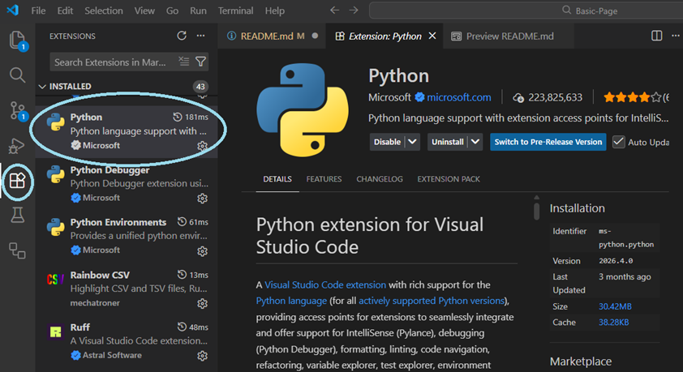
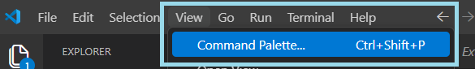
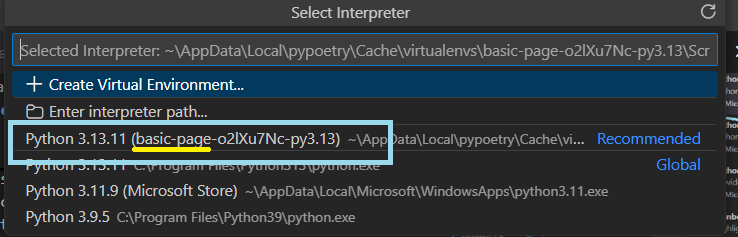
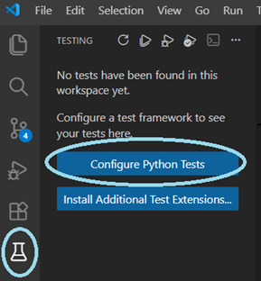
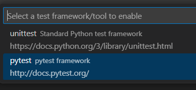
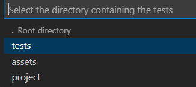
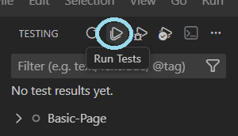

# Image Gallery Project

## Learning Target
This project involves designing and coding an image gallery that displays a minimum of 9 thumbnail images. Each thumbnail links to a full-sized version, and the layout should be responsive and visually styled.

---
[top](#image-gallery-project) | [learning target](#learning-target) | [instructions](#instructions) | [project requirements](#project-requirements) | [grading](#grading)

## Instructions:
Once you have accepted the assignment and have a copy of your repo...

### Project Setup

<b><i>* Testing Setup</i></b>

***NOTE**: this step is only necessary if you want to check to make sure you've met all your `HTML` and `CSS` requirements.*

* Open the Software Center and make sure the following apps are installed in the following order...
    - Python
    - Python Poetry
    - Python pip-system-certs
* Open your project in VSCode.
* Make sure that the Python Extension from Microsoft is installed
    
* Open the terminal (Terminal > New Terminal)
* Type: `poetry env activate`
* Type: `poetry update`
* Open the Command Palette
    - Click on the View Menu then select Command Palette
    
    *OR*
    - Type `CTRL` + `Shift` + `P`
* In the Command Palette...
    - Type: "Python: Select Interpreter"
    - Select the one that states basic-page and shows "poetry" on the side.
    

<b><i>* Testing your project using pytest</i></b>

***NOTE**: this too is only necessary to test your project to see if you meet all `HTML` and `CSS` coding requirements.

1. Click the Test Icon (a flask) and choose "Configure Python Tests"

    
2. Select the "pytest" test option

    
3. Select the tests folder

    
4. Click the run test icon

    
5. NOTE: you will fail tests until you begin coding and meeting requirements.

### Working on Your Project 

<b>Adding your Web Content</b>

1. Open your project in VSCode.
2. Create a file named `index.html` in the project folder.
3. Add the basic HTML code to `index.html`
4. Create an `images` folder inside the `project` folder
5. Choose a theme for your gallery
6. Find at least 9 large images online that are related to the theme you have selected (you will need to cite the images so don't lose the links).
7. Save each large image into the `images` folder.
8. For each large image, create a smaller thumbnail version that is only around 300-500 pixels wide and you must give it a new name
    - NOTE: I recommend cropping the image to be a teaser.
9. Review the [Project Requirements](#project-requirements) below
10. Pay close attention to the in-class demonstrations on how to display the image gallery
    - It will involve styling the header with a background image (for best effect)
    - Find a good Google font or pair for additional style
    - Try pulling a color palette from the image used for the header background
    - Use the box model to set the width, background color, padding, and border around the figure
    - Make the main tag set to display as flex
    - Use the flex model to create a responsive display
    - Consider rounded corners, box-shadows, and even transitions to make the gallery be more dynamic.
11. Test as you go.
12. Show it to your peers and get feedback.
13. Commit and push your work each day to make sure you don't lose any work and track your progress.
14. Record your final product showing responsiveness
15. Turn in your project by sending your teacher a URL to your repo.

---
## Project Requirements

<strong>Requirements</strong>

### Folder and File Structure
- Create a single web page named `index.html`
- Create a folder titled `images` (all lowercase)
- Include at least 18 images:
  - 9 full-sized images
  - 9 thumbnails (max width: 450px)

### HTML Requirements
- A single HTML file with:
  - All standard HTML5 tags (`DOCTYPE`, `html`, `head`, `title`, `body`)
  - A `header` with a `h1` title
  - A `main` section containing at least 9 `figure` elements
  - Each `figure` includes:
    - A thumbnail image with `alt` text
    - A link to the full-sized image
    - A `figcaption` with a `cite` tag for image credit (linked if not self-taken)

### CSS Requirements
- Use at least one stylesheet or a `<style>` tag
- Font pairing
- Background and text colors with proper contrast:
  - AAA rating for body text
  - AA rating acceptable for headings
- Use `flex` layout for the container
- Style `figure` elements with `margin`, `border`, `padding`, and `background-color`

### Design Requirements
- High contrast and readability
- Thematically consistent images and styling
- Responsive layout that works across all screen sizes

### Validity Requirements
- No HTML or CSS errors (validated via W3C tools)

### For the Win (to get exceeds)
- at least 12 image tags (inside of figure tags, each with a figcaption)
- at least 24 images in all (1 for thumbnail and 1 for full-sized)
- at least 12 links
- must use at least 2 of the following CSS properties applied to the figure (box-shadow, border-radius, or animation)
- must use 

---

<strong>Submission Requirements</strong>

- All changes must be committed and pushed to the repository
- Submit a recording showing the gallery at various viewport widths
- I will be looking for the following design recommendations:
    + your ***layout remains intact*** at all screen widths
    + there are ***no horizontal scrollbars*** (unless the screen is narrower than a single figure)

---
